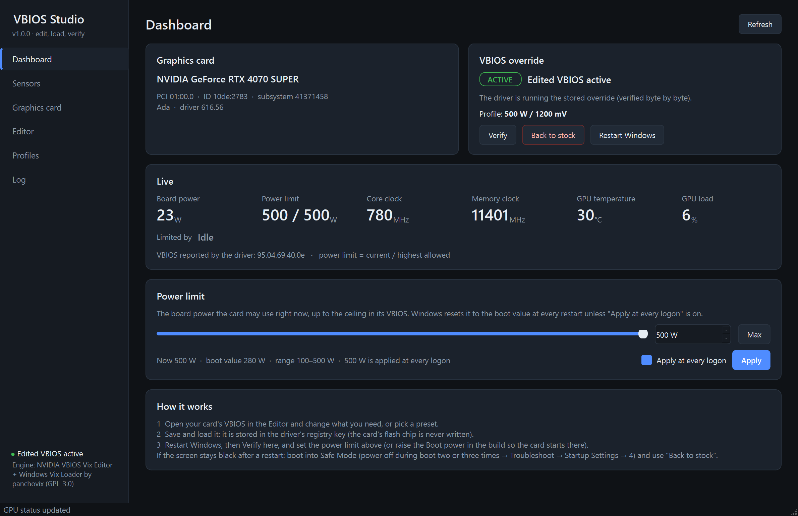
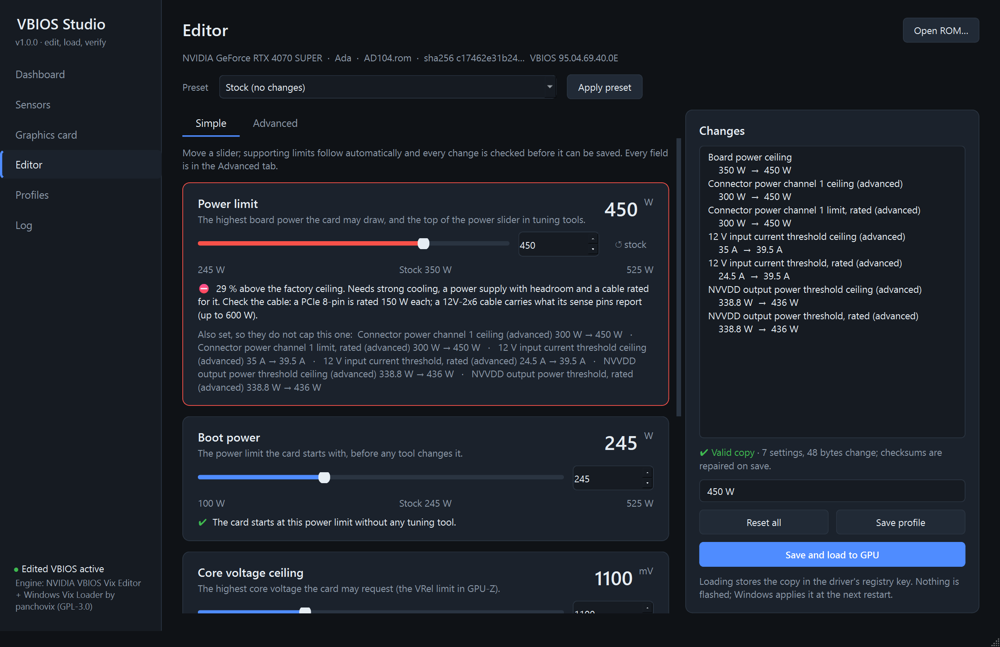
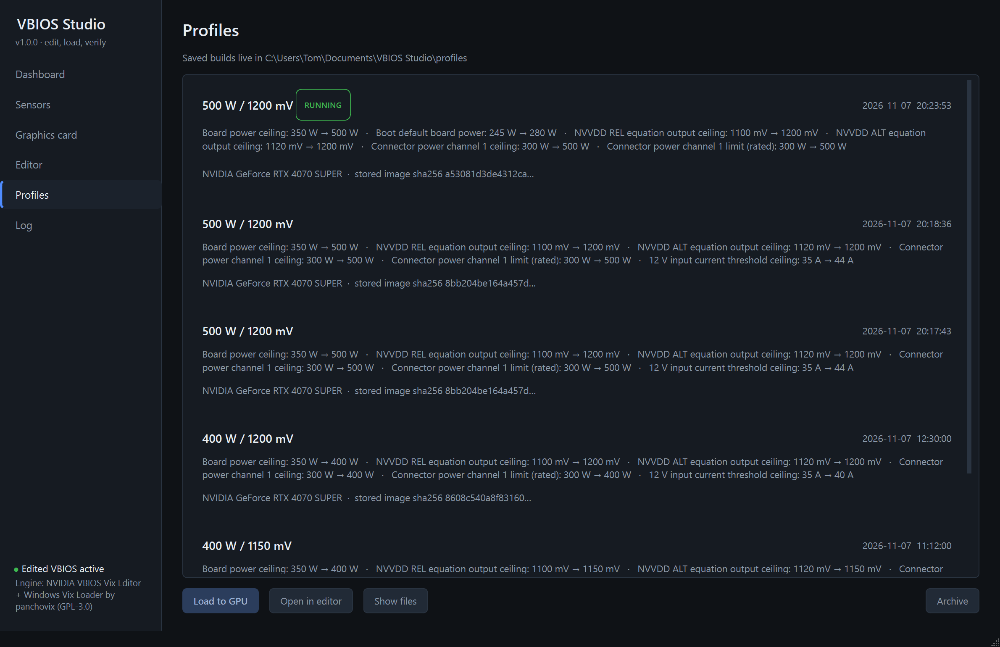

# VBIOS Studio

One Windows app to edit a copy of an NVIDIA VBIOS, load it through the driver's registry override, restart and
verify that it is running. It covers Turing, Ampere, Ada and Blackwell cards.

The card's flash chip is never written. The edited copy lives in the GPU's driver registry key, the driver uses it
after a Windows restart, and "Back to stock" removes it.

## What is in the window

- **Dashboard** shows the card, its driver and the override state:
  - **STOCK**: no override is stored.
  - **PENDING**: stored, waiting for a restart.
  - **ACTIVE**: verified byte by byte.
  - **NOT RUNNING**: stored, but the driver refused it.

  It also shows which saved profile is loaded, live power, limits, clocks, temperature and load, and what is holding
  the card back (power limit, voltage ceiling/VRel, temperature: like GPU-Z's PerfCap reason). It has Verify, Back to
  stock and Restart Windows buttons.
- **Power limit** on the Dashboard does what a tuning tool's power slider does, without one. Set any limit up to the
  VBIOS ceiling and apply it now (one administrator prompt). Optionally re-apply it at every logon: Windows resets the
  limit to the VBIOS boot value at each restart, so this runs nvidia-smi through a SYSTEM scheduled task named
  \"VBIOS Studio power limit\". To remove that task, untick the box and click Apply. If another tool also sets the power
  limit at startup, the last one to run wins.
- **Sensors** shows every reading the driver exposes, live, with current, minimum, maximum and average, and can log
  to CSV:
  - **Clocks:** GPU, SM, memory and video.
  - **Temperatures:** GPU, **hot spot** and **memory junction**, plus the max-operating, slowdown and shutdown
    thresholds.
  - **Power:** **core voltage**, board power draw, chip and board power as % of TDP, the enforced, boot-default and
    range limits, and the energy used.
  - **Loads:** GPU, memory controller, video engine, bus interface, encoder and decoder.
  - **Memory and PCIe:** VRAM used and free, BAR1, PCIe link, receive and transmit throughput, and replay errors.
  - **Fans:** % and RPM.
  - **Limits:** the P-state, the live PerfCap reason, and how long the card has been held back by power, temperature,
    voltage (VRel) and board limits.
  - **System:** system memory and CPU load.
- **Graphics card** is a GPU-Z-style sheet:
  - Chip, process, die size, transistors, BIOS version, subvendor and device ID.
  - Bus interface: the card's own PCIe maximum against what the slot or platform allows.
  - Shaders, SMs, TMUs, Tensor and RT cores.
  - Memory size, bus width, clock and bandwidth.
  - Base and boost clocks, Resizable BAR, driver, CUDA version and compute capability.

  **Save BIOS** writes the image the driver is running to a file.
- **Editor, Simple tab**: a slider card for each setting most people change: power limit, boot power, core voltage
  ceiling, core clock offset range and temperature limit.
  - Each card has a stock marker, a reset button, and a warning that turns amber or red as you go past factory
    values.
  - **Supporting limits follow automatically.** Raising the power limit also raises the connector, 12 V input current
    and core-rail power limits that would otherwise cap the card below it. Raising the voltage ceiling raises the ALT
    ceiling with it. The card lists exactly what it set.
- **Editor, Advanced tab**: every field the editor knows, grouped as Power, Voltage, Clocks, Current, Fans and
  Advanced.
  - Search filters the list. "Show XOC fields" reveals the opt-in limits, and experimental and XOC rows carry badges.
  - Hover a row for the editor's own explanation of it.
- In both tabs, every change is validated as you make it, against the same rules as the original editor. The Changes
  panel lists everything that moves, presets apply a saved change set, and "Save and load to GPU" does the rest in
  one step.
- **Profiles**: every build is kept as a folder with the edited ROM, the loader payload, the source ROM and the
  change set. The one that is running is marked. A profile can be loaded again or reopened in the editor, and old
  ones go to `_archive` instead of being deleted.
- **Log** keeps every build, load and removal.

Profiles live in `Documents\VBIOS Studio\profiles`.

The presets in `vbios_studio/presets/` are examples made for one card: a Gigabyte RTX 4070 SUPER on a custom water
loop, fed by a 600 W 12V-2x6 cable. They raise power, connector and current limits and the core voltage ceiling.
Do not apply them to another card without checking every value against your own card, cable and cooling. Add your
own presets as JSON files in that folder.





## Download

Get `VBIOS Studio.exe` from [Releases](../../releases). It is portable: one file, with no Python and no install
needed. Windows 10 or 11 (64-bit) and an NVIDIA driver 616.56 or newer are required to load an override.

Check the download against `SHA256SUMS.txt`:

```
Get-FileHash "VBIOS Studio.exe"
```

The exe is not code-signed. SmartScreen may warn on first start (More info → Run anyway). Some antivirus tools flag
unsigned single-file Python apps. If yours does, build it yourself from source (below) or run it from source.

Loading and removing an override shows one administrator prompt each. Everything else runs without admin rights.

## Run from source

Use Python 3.11 or newer:

```
python -m venv .venv
.venv\Scripts\pip install PySide6
.venv\Scripts\python -m vbios_studio          (or double-click VBIOS Studio.cmd)
```

Build the portable exe (PyInstaller, output in `dist\`):

```
powershell -ExecutionPolicy Bypass -File packaging\build.ps1
```

## Safety

- Test on a GPU that is not driving your only display when you can.
- If the screen stays black after a restart:
  1. Boot into Safe Mode. Turn the PC off during boot two or three times, then choose Troubleshoot → Advanced
     options → Startup Settings → 4.
  2. The NVIDIA driver does not load in Safe Mode, so the screen works. Right-click
     `Back to stock (Safe Mode).cmd` → Run as administrator, then restart.
- Raising power, current or voltage limits can damage hardware. The editor's notes, shown as tooltips, say what has
  been tested on which cards.

## Tests

`tests\` covers the backend and the window, offscreen. The tests open your ROM, build profiles in a temporary
folder and read the GPU state. They never load or unload anything.

```
.venv\Scripts\python -m tests.test_backend path\to\card.rom
.venv\Scripts\python -m tests.test_ui path\to\card.rom
```

The tests apply the example presets. On a card where those values are out of range, a test fails with the editor's
reason for refusing them, which is the behaviour you want.

## Credits and license

**The engine is panchovix's work.** The ROM parsing, validation, relocation and the registry loader in
`vendor/nvidia_vbios` are the [NVIDIA VBIOS Vix Editor](https://github.com/Panchovix/nvidia-vbios-vix-editor) 0.1.43
and the [NVIDIA Windows VBIOS Vix Loader](https://github.com/Panchovix/nvidia-windows-vbios-vix-loader) 0.4.1 by
panchovix. They build on pantsoftime's original `vbios_override` research
([overclock.net](https://www.overclock.net)) and are bundled unchanged, merged into one package. VBIOS Studio
replaces only their user interfaces. See [CREDITS.md](CREDITS.md).

VBIOS Studio is GPL-3.0-or-later, like the code it builds on (see `LICENSE` and `vendor/licenses`). It comes with no
warranty. You are responsible for what you load onto your hardware. Not affiliated with or endorsed by NVIDIA,
panchovix or pantsoftime.
